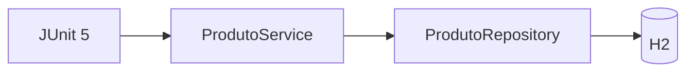
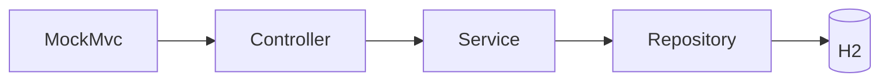

# Demonstração guiada — Testes de integração com Spring Boot e JUnit 5

**Ambiente:** Java 17+, Maven, Spring Boot 3.3.13, Spring Data JPA, H2, JUnit 5 e MockMvc.  
**Objetivo:** construir progressivamente uma aplicação mínima de produtos e demonstrar dois níveis de integração: `Service → Repository → H2` e `HTTP simulado → Controller → Service → Repository → H2`.

> Este ZIP contém o **resultado final executável**. Para demonstrar a construção ao vivo, siga as etapas abaixo e crie cada arquivo apenas quando ele for solicitado. Os códigos completos estão em `src/`.

## Requisitos e casos de teste

| Regra | Descrição | Teste |
|---|---|---|
| RN01 | Produto deve possuir nome não vazio. | Rejeição no serviço (extensão) |
| RN02 | Preço deve ser maior que zero. | Rejeição no serviço (extensão) |
| RN03 | Produto cadastrado deve ser persistido. | `deveCadastrarEPersistirProduto` |
| RN04 | Produto deve ser consultável pelo identificador. | `buscar` (extensão) |
| RN05 | Cadastro via HTTP deve retornar dados do produto. | `deveCadastrarProdutoViaHttp` |

## Roteiro passo a passo para o professor

### Etapa 0 — Criar projeto Maven
1. IntelliJ → New Project → Spring Initializr (ou importar `pom.xml`).
2. Java 17; dependências **Spring Web**, **Spring Data JPA**, **H2 Database**, **Spring Boot Starter Test**.
3. Mostre o `pom.xml`, a classe `Aplicacao` e `application.properties`.
4. Explique que `@SpringBootApplication` define a raiz do escaneamento dos componentes.

### Etapa 1 — Apresentar a arquitetura



**Pergunta:** se `ProdutoService` funciona sozinho, sabemos se o `Repository` realmente salva no banco? **Não.**

### Etapa 2 — Criar `Produto` e `ProdutoRepository`
1. Crie `model/Produto.java`: `@Entity`, `@Id`, `@GeneratedValue`, construtor protegido sem argumentos, construtor com nome/preço, getters.
2. Crie `repository/ProdutoRepository.java` estendendo `JpaRepository<Produto, Long>`.
3. Discuta o papel do JPA: implementação de `save()` e `findById()` fornecida pelo Spring Data.

### Etapa 3 — Criar `ProdutoService`
1. Adicione `@Service`.
2. Injete `ProdutoRepository` pelo construtor.
3. Implemente `cadastrar(nome, preco)` com validações e `repository.save(new Produto(...))`.
4. Implemente `buscar(id)` com `findById`.
5. **Pergunta:** quem instancia o repositório? O contexto do Spring.

### Etapa 4 — Escrever o primeiro teste de integração
1. Crie `ProdutoServiceIntegrationTest`.
2. Anote com `@SpringBootTest` e `@Transactional`.
3. Injete `ProdutoService` e `ProdutoRepository` com `@Autowired`.
4. Escreva o teste `deveCadastrarEPersistirProduto`.
5. Execute `mvn -Dtest=ProdutoServiceIntegrationTest test`.
6. Mostre o ID gerado e a consulta com `findById()`.
7. Discuta: `@SpringBootTest` carrega contexto real; `@Transactional` normalmente desfaz operações após cada teste.

**Nota técnica:** `repository.flush()` força o envio de SQL pendente, mas uma consulta JPA dentro da mesma transação pode reutilizar o contexto de persistência. Para demonstrar leitura efetiva do banco, veja a extensão com `EntityManager.clear()` abaixo.

### Etapa 5 — Evidenciar a leitura do banco (extensão recomendada)
No teste do serviço, injete:

```java
@PersistenceContext
EntityManager entityManager;
```

Depois de cadastrar:

```java
repository.flush();
entityManager.clear();
Produto encontrado = repository.findById(salvo.getId()).orElseThrow();
```

Importe `jakarta.persistence.EntityManager` e `jakarta.persistence.PersistenceContext`. Assim, a entidade é recarregada do banco em vez de ser recuperada apenas do cache de primeiro nível.

### Etapa 6 — Introduzir a camada HTTP
1. Crie o record `ProdutoRequest(nome, preco)`.
2. Crie `ProdutoController` com `@RestController` e `@RequestMapping("/produtos")`.
3. Implemente `POST /produtos` delegando ao serviço.
4. Implemente `GET /produtos/{id}`.



### Etapa 7 — Testar o fluxo HTTP completo
1. Crie `ProdutoControllerIntegrationTest`.
2. Adicione `@SpringBootTest`, `@AutoConfigureMockMvc`, `@Transactional`.
3. Injete `MockMvc`.
4. Envie JSON para `POST /produtos`.
5. Verifique status 200 (padrão do método atual), nome, preço e ID.
6. Execute `mvn -Dtest=ProdutoControllerIntegrationTest test`.

**Discussão:** MockMvc executa o fluxo MVC sem abrir uma porta HTTP; o controller, o service, o repository e o H2 são reais.

### Etapa 8 — Mostrar o isolamento dos testes
- Execute `mvn test` duas vezes; os testes não devem depender da ordem.
- `@Transactional` no teste reverte as alterações ao final (neste fluxo com MockMvc, sem servidor real e com execução na mesma thread).
- **Atenção:** testes com `RANDOM_PORT` e chamadas HTTP reais normalmente executam a requisição em outra thread/transação; rollback do teste não limpa automaticamente essas alterações.

### Etapa 9 — Exercícios de extensão em sala
1. Escreva teste que rejeite preço zero e confirme que a contagem do repositório não mudou.
2. Cadastre um produto e teste `service.buscar(id)`.
3. Envie `GET /produtos/{id}` com MockMvc e verifique JSON.
4. Teste nome em branco.

## Como executar

```bash
mvn test
mvn spring-boot:run
```

Com a aplicação rodando, testar manualmente:

```bash
curl -X POST http://localhost:8080/produtos \
  -H 'Content-Type: application/json' \
  -d '{"nome":"Teclado","preco":150.0}'
```

## Observações didáticas
- Este é um exemplo de **teste de integração**, não uma demonstração estrita de TDD: a aplicação pode ser construída antes dos testes para destacar a integração.
- `@SpringBootTest` isoladamente não garante que o teste exercite vários componentes; isso depende do que ele executa.
- No controller atual, entradas inválidas lançam `IllegalArgumentException` sem tratamento HTTP específico. Não prometa status 400 antes de adicionar tratamento de exceções.
- `double` foi adotado por simplicidade didática. Para valores monetários reais, prefira `BigDecimal`.
- O exemplo usa H2 em memória; não garante equivalência com PostgreSQL ou outro banco de produção.
